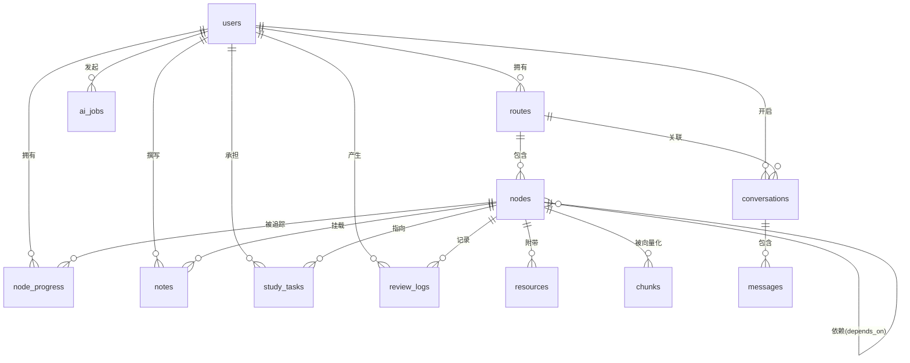

# 02 · 领域模型与数据库设计

> 术语定义见 `01-产品设计.md` 第 4 节。本文档只讲"怎么存"。

---

## 1. 存储选型

| 数据 | 存储 | 理由 |
|---|---|---|
| 路线、节点、依赖、进度、笔记、任务 | **PostgreSQL 16** | 强关系、需要外键和事务；依赖图需要递归查询（CTE） |
| 向量（笔记、节点的 embedding） | **PostgreSQL + pgvector** | 数据量与关系数据强耦合，单独引入向量库不值得；pgvector 支持 HNSW 索引，性能对个人项目绰绰有余 |
| 缓存、限流计数、Celery 结果 | **Redis 7** | 见 `03-技术架构.md` |
| 异步任务队列 | **RabbitMQ** | 见 `03-技术架构.md` |
| 会话消息（可选） | PostgreSQL | 量小，不需要单独存储；消息结构用 JSONB 存 meta |

**为什么不用独立的向量数据库（Chroma / Milvus / Qdrant）**

1. 引入一个新的有状态服务，运维成本翻倍
2. 笔记量与节点量在个人项目规模下不超过 10 万条 chunk，pgvector 完全够用
3. 向量检索需要和关系数据做 join（例如"检索结果必须属于当前路线"），放在同一个库里可以直接 SQL 过滤，跨库则需要在应用层做二次过滤
4. 少一个服务 = 少一个故障点

**什么时候应该换掉 pgvector**：单表超过 500 万向量，或检索 P95 超过 200ms 时。届时可以平滑迁移到 Qdrant，接口层不变（见 `06-AI能力设计.md` 的 `VectorStore` 抽象）。

---

## 2. 实体关系总览



**注意**：`nodes` 自引用多对多（依赖关系）通过中间表 `node_dependencies` 实现，Mermaid 的 `nodes ||--o{ nodes` 是它的逻辑表达。

---

## 3. 完整 DDL

> 以下 DDL 是**权威定义**。Alembic 迁移必须与此一致。
> 命名约定：表名小写下划线复数；外键 `<单数表名>_id`；时间戳统一 `created_at` / `updated_at`，类型 `TIMESTAMPTZ`。

### 3.0 扩展与公共部分

```sql
-- 必须最先执行
CREATE EXTENSION IF NOT EXISTS "pgcrypto";   -- gen_random_uuid()
CREATE EXTENSION IF NOT EXISTS "vector";     -- pgvector
CREATE EXTENSION IF NOT EXISTS "pg_trgm";    -- 全文模糊搜索（笔记搜索用）

-- 统一的时间戳触发器函数
CREATE OR REPLACE FUNCTION set_updated_at()
RETURNS TRIGGER AS $$
BEGIN
    NEW.updated_at = now();
    RETURN NEW;
END;
$$ LANGUAGE plpgsql;
```

**主键策略**：所有业务表使用 `UUID` 主键（`gen_random_uuid()`），而不是自增整数。理由：

1. 前端可以在本地先生成 ID（乐观更新），服务端不需要回传
2. 导出/导入数据时不会冲突
3. 不会通过 ID 泄露数据规模

### 3.1 users

```sql
CREATE TABLE users (
    id            UUID        PRIMARY KEY DEFAULT gen_random_uuid(),
    email         VARCHAR(255) UNIQUE,
    display_name  VARCHAR(100) NOT NULL DEFAULT '我',
    settings      JSONB        NOT NULL DEFAULT '{}'::jsonb,
    created_at    TIMESTAMPTZ  NOT NULL DEFAULT now(),
    updated_at    TIMESTAMPTZ  NOT NULL DEFAULT now()
);

CREATE TRIGGER trg_users_updated_at
    BEFORE UPDATE ON users
    FOR EACH ROW EXECUTE FUNCTION set_updated_at();
```

**`settings` JSONB 结构约定**（不做成列，因为这些是易变的偏好）：

```jsonc
{
  "daily_minutes": 60,              // 每天可用学习时长（分钟），任务编排用
  "prefer_weekend": false,          // 是否更倾向周末学习
  "review_intervals": [1, 3, 7, 15, 30, 60],  // 间隔重复的天数序列
  "llm": {
    "provider": "openai",
    "model": "gpt-4o-mini",
    "temperature": 0.3
  },
  "theme": "light"
}
```

> **MVP 说明**：阶段一单用户，启动时由种子脚本插入固定 ID 的用户记录。**不要**硬编码 ID，而是通过 `settings.owner_key = 'default'` 查询，见 3.11 的查询示例。

### 3.2 routes（路线）

```sql
CREATE TABLE routes (
    id           UUID         PRIMARY KEY DEFAULT gen_random_uuid(),
    user_id      UUID         NOT NULL REFERENCES users(id) ON DELETE CASCADE,
    title        VARCHAR(200) NOT NULL,
    description  TEXT         NOT NULL DEFAULT '',
    is_active    BOOLEAN      NOT NULL DEFAULT true,
    cover_emoji  VARCHAR(8),                       -- 仅用于视觉区分，不参与逻辑
    source       VARCHAR(20)  NOT NULL DEFAULT 'manual',
                 -- manual | template | ai_draft
    created_at   TIMESTAMPTZ  NOT NULL DEFAULT now(),
    updated_at   TIMESTAMPTZ  NOT NULL DEFAULT now()
);

CREATE INDEX idx_routes_user          ON routes(user_id);
CREATE INDEX idx_routes_user_active   ON routes(user_id, is_active) WHERE is_active;

CREATE TRIGGER trg_routes_updated_at
    BEFORE UPDATE ON routes
    FOR EACH ROW EXECUTE FUNCTION set_updated_at();
```

### 3.3 nodes（知识节点）

```sql
CREATE TABLE nodes (
    id             UUID         PRIMARY KEY DEFAULT gen_random_uuid(),
    route_id       UUID         NOT NULL REFERENCES routes(id) ON DELETE CASCADE,
    title          VARCHAR(200) NOT NULL,
    summary        TEXT         NOT NULL DEFAULT '',
    exit_criteria  TEXT         NOT NULL DEFAULT '',   -- 出口条件，见 01 文档术语表
    level          SMALLINT     NOT NULL DEFAULT 1,    -- 难度 1/2/3
    position       INTEGER      NOT NULL DEFAULT 0,    -- 同一模块内的排序
    module_name    VARCHAR(100) NOT NULL DEFAULT '',   -- 所属模块，冗余存储便于分组查询
                 
    created_at     TIMESTAMPTZ  NOT NULL DEFAULT now(),
    updated_at     TIMESTAMPTZ  NOT NULL DEFAULT now(),

    CONSTRAINT chk_nodes_level CHECK (level BETWEEN 1 AND 3)
);

CREATE INDEX idx_nodes_route          ON nodes(route_id, position);
CREATE INDEX idx_nodes_route_module   ON nodes(route_id, module_name, position);
CREATE INDEX idx_nodes_title_trgm     ON nodes USING gin (title gin_trgm_ops);

CREATE TRIGGER trg_nodes_updated_at
    BEFORE UPDATE ON nodes
    FOR EACH ROW EXECUTE FUNCTION set_updated_at();
```

**关于 `module_name` 为什么是字符串而不是外键**

模块是**纯展示用的分组**，不具备独立生命周期（没有"模块"级的进度、设置或权限）。用独立表会引入一次多余的 join，而模块改名是极低频操作。**这是刻意的反范式设计**，如果将来模块需要独立属性（如模块级目标、模块级资源），再拆表。

### 3.4 node_dependencies（依赖边表）

```sql
CREATE TABLE node_dependencies (
    node_id        UUID        NOT NULL REFERENCES nodes(id) ON DELETE CASCADE,
    depends_on_id  UUID        NOT NULL REFERENCES nodes(id) ON DELETE CASCADE,
    created_at     TIMESTAMPTZ NOT NULL DEFAULT now(),

    PRIMARY KEY (node_id, depends_on_id),
    CONSTRAINT chk_no_self_dep CHECK (node_id <> depends_on_id)
);

-- 反向查询索引：查"哪些节点依赖了我"
CREATE INDEX idx_node_deps_reverse ON node_dependencies(depends_on_id);
```

**重要：环检测**

依赖图必须是有向无环图（DAG）。**数据库层无法用简单的 CHECK 约束保证这一点**，必须在应用层实现。

检测算法（每次新增依赖 `B depends_on A` 时执行）：

```
判断插入 A → B 后是否成环，等价于判断：
    从 A 出发，沿 depends_on 方向能否到达 B

若能到达，则插入后会形成环，必须拒绝。
```

SQL 实现（递归 CTE）：

```sql
-- 参数: $1 = 将要被依赖的节点 (A), $2 = 将要添加依赖的节点 (B)
-- 返回行数 > 0 表示会成环，必须拒绝
WITH RECURSIVE reach AS (
    SELECT depends_on_id AS id
    FROM node_dependencies
    WHERE node_id = $1

    UNION

    SELECT nd.depends_on_id
    FROM node_dependencies nd
    JOIN reach r ON nd.node_id = r.id
)
SELECT 1 FROM reach WHERE id = $2 LIMIT 1;
```

**这是必须写单元测试的逻辑**，测试用例见 `08-开发计划.md` M3。

### 3.5 node_progress（进度）

```sql
CREATE TABLE node_progress (
    id              UUID         PRIMARY KEY DEFAULT gen_random_uuid(),
    user_id         UUID         NOT NULL REFERENCES users(id) ON DELETE CASCADE,
    node_id         UUID         NOT NULL REFERENCES nodes(id) ON DELETE CASCADE,
    status          VARCHAR(20)  NOT NULL DEFAULT 'not_started',
                    -- not_started | learning | mastered | needs_review
    mastery         SMALLINT     NOT NULL DEFAULT 0,     -- 0..5 自评掌握度
    review_stage    SMALLINT     NOT NULL DEFAULT 0,     -- 当前处于复习间隔序列的第几档
    last_studied_at TIMESTAMPTZ,
    mastered_at     TIMESTAMPTZ,
    review_due_at   TIMESTAMPTZ,                          -- 下次应复习时间
    created_at      TIMESTAMPTZ  NOT NULL DEFAULT now(),
    updated_at      TIMESTAMPTZ  NOT NULL DEFAULT now(),

    CONSTRAINT uq_progress_user_node UNIQUE (user_id, node_id),
    CONSTRAINT chk_mastery CHECK (mastery BETWEEN 0 AND 5),
    CONSTRAINT chk_review_stage CHECK (review_stage BETWEEN 0 AND 10)
);

CREATE INDEX idx_progress_user             ON node_progress(user_id);
CREATE INDEX idx_progress_node             ON node_progress(node_id);
CREATE INDEX idx_progress_due              ON node_progress(user_id, review_due_at)
    WHERE status = 'mastered';
CREATE INDEX idx_progress_status           ON node_progress(user_id, status);

CREATE TRIGGER trg_progress_updated_at
    BEFORE UPDATE ON node_progress
    FOR EACH ROW EXECUTE FUNCTION set_updated_at();
```

**`review_due_at` 的计算规则**（间隔重复）：

| 事件 | review_stage 变化 | review_due_at | status 变化 |
|---|---|---|---|
| 首次标记为 mastered | 0 | `now() + intervals[0]` 天 | → `mastered` |
| 复习通过（"还记得"） | +1 | `now() + intervals[stage]` 天 | 保持 `mastered` |
| 复习失败（"忘了"） | 归 0 | `now() + intervals[0]` 天 | → `needs_review` |
| 超过 due 时间未复习 | 不变 | 不变 | → `needs_review` |

其中 `intervals` 来自 `users.settings.review_intervals`，默认 `[1, 3, 7, 15, 30, 60]`。
`review_stage` 超出序列长度时，持续使用最后一个间隔。

**重要设计决策：`node_progress` 记录是懒创建的。**

不要在每个节点创建时批量插入进度记录。只有在用户**第一次操作**该节点时才 upsert。查询时用 `LEFT JOIN` + `COALESCE(status, 'not_started')`。
理由：一条 100 节点的路线如果为每个用户都预插记录，会产生大量无意义数据；而且路线增删节点时需要同步维护，容易出错。

### 3.6 notes（笔记）

```sql
CREATE TABLE notes (
    id          UUID        PRIMARY KEY DEFAULT gen_random_uuid(),
    user_id     UUID        NOT NULL REFERENCES users(id) ON DELETE CASCADE,
    node_id     UUID        NOT NULL REFERENCES nodes(id) ON DELETE CASCADE,
    content     TEXT        NOT NULL DEFAULT '',
    is_pinned   BOOLEAN     NOT NULL DEFAULT false,
    created_at  TIMESTAMPTZ NOT NULL DEFAULT now(),
    updated_at  TIMESTAMPTZ NOT NULL DEFAULT now(),

    -- MVP: 一个用户对一个节点一篇笔记（upsert 语义）
    -- 未来支持多篇时，删除此约束，改为普通索引
    CONSTRAINT uq_notes_user_node UNIQUE (user_id, node_id)
);

CREATE INDEX idx_notes_user     ON notes(user_id);
CREATE INDEX idx_notes_node     ON notes(node_id);
CREATE INDEX idx_notes_content_trgm ON notes USING gin (content gin_trgm_ops);

CREATE TRIGGER trg_notes_updated_at
    BEFORE UPDATE ON notes
    FOR EACH ROW EXECUTE FUNCTION set_updated_at();
```

**笔记内容限制**：单篇不超过 100,000 字符（约 30 万字节）。超长内容建议用户拆分成多个节点，而不是把整个课程抄进来。应用层校验，不在 DB 层加 CHECK（避免大文本比较开销）。

### 3.7 resources（资源）

```sql
CREATE TABLE resources (
    id          UUID         PRIMARY KEY DEFAULT gen_random_uuid(),
    node_id     UUID         NOT NULL REFERENCES nodes(id) ON DELETE CASCADE,
    name        VARCHAR(300) NOT NULL,
    location    VARCHAR(500) NOT NULL DEFAULT '',
                 -- 可以是 URL，也可以是"在哪找"的描述（如 "B站搜 XXX"）
    kind        VARCHAR(20)  NOT NULL DEFAULT 'other',
                 -- doc | video | book | course | repo | paper | other
    position    INTEGER      NOT NULL DEFAULT 0,
    created_at  TIMESTAMPTZ  NOT NULL DEFAULT now()
);

CREATE INDEX idx_resources_node ON resources(node_id, position);

-- 软性约束：每个节点最多 2 条资源（产品原则：收敛资料，不是增加）
-- PostgreSQL 无法用简单 CHECK 表达"每节点最多 N 条"，需用触发器
CREATE OR REPLACE FUNCTION enforce_resource_limit()
RETURNS TRIGGER AS $$
BEGIN
    IF (SELECT count(*) FROM resources WHERE node_id = NEW.node_id) >= 2 THEN
        RAISE EXCEPTION '每个节点最多 2 条资源（产品设计约束，见 01-产品设计.md F19）';
    END IF;
    RETURN NEW;
END;
$$ LANGUAGE plpgsql;

CREATE TRIGGER trg_resources_limit
    BEFORE INSERT ON resources
    FOR EACH ROW EXECUTE FUNCTION enforce_resource_limit();
```

> **这个触发器是产品原则的技术兜底。** "收敛资料"不能只写在文档里，要在数据库层面拦下来，否则迟早会失控。

### 3.8 review_logs（复习记录）

```sql
CREATE TABLE review_logs (
    id            UUID        PRIMARY KEY DEFAULT gen_random_uuid(),
    user_id       UUID        NOT NULL REFERENCES users(id) ON DELETE CASCADE,
    node_id       UUID        NOT NULL REFERENCES nodes(id) ON DELETE CASCADE,
    result        VARCHAR(20) NOT NULL,
                  -- remembered | forgot | skipped
    stage_before  SMALLINT    NOT NULL,
    stage_after   SMALLINT    NOT NULL,
    reviewed_at   TIMESTAMPTZ NOT NULL DEFAULT now()
);

CREATE INDEX idx_review_logs_node ON review_logs(node_id, reviewed_at DESC);
CREATE INDEX idx_review_logs_user ON review_logs(user_id, reviewed_at DESC);
```

这张表是**只增不改**的日志表，用于：
1. 复习历史展示
2. 未来做"遗忘曲线分析"
3. 调试间隔重复算法

### 3.9 conversations & messages（会话）

```sql
CREATE TABLE conversations (
    id          UUID         PRIMARY KEY DEFAULT gen_random_uuid(),
    user_id     UUID         NOT NULL REFERENCES users(id) ON DELETE CASCADE,
    route_id    UUID         REFERENCES routes(id) ON DELETE SET NULL,
    node_id     UUID         REFERENCES nodes(id) ON DELETE SET NULL,
                 -- 若对话是从某节点进入的，记录下来
    title       VARCHAR(200) NOT NULL DEFAULT '新对话',
    created_at  TIMESTAMPTZ  NOT NULL DEFAULT now(),
    updated_at  TIMESTAMPTZ  NOT NULL DEFAULT now()
);

CREATE INDEX idx_conversations_user ON conversations(user_id, updated_at DESC);

CREATE TABLE messages (
    id               UUID        PRIMARY KEY DEFAULT gen_random_uuid(),
    conversation_id  UUID        NOT NULL REFERENCES conversations(id) ON DELETE CASCADE,
    role             VARCHAR(20) NOT NULL,          -- user | assistant | system
    content          TEXT        NOT NULL,
    meta             JSONB       NOT NULL DEFAULT '{}'::jsonb,
    seq              INTEGER     NOT NULL,           -- 会话内自增序号，保证顺序
    created_at       TIMESTAMPTZ NOT NULL DEFAULT now(),

    CONSTRAINT chk_message_role CHECK (role IN ('user', 'assistant', 'system')),
    CONSTRAINT uq_message_seq UNIQUE (conversation_id, seq)
);

CREATE INDEX idx_messages_conv ON messages(conversation_id, seq);
```

**`messages.meta` JSONB 结构约定**：

```jsonc
{
  "model": "gpt-4o-mini",
  "prompt_tokens": 1240,
  "completion_tokens": 320,
  "latency_ms": 1830,
  "context_snapshot_id": null,     // 预留：如果做了快照持久化
  "error": null                    // 失败时的错误信息
}
```

**关于消息内容长度**：`content` 用 `TEXT`（无长度限制）。但应用层需要限制单条不超过 50,000 字符，且在组装上下文时做截断（见 `06`）。

### 3.10 study_tasks（学习任务）

```sql
CREATE TABLE study_tasks (
    id            UUID         PRIMARY KEY DEFAULT gen_random_uuid(),
    user_id       UUID         NOT NULL REFERENCES users(id) ON DELETE CASCADE,
    node_id       UUID         REFERENCES nodes(id) ON DELETE CASCADE,
                   -- 可以为空：任务不一定绑定节点（如"复习本周所有节点"）
    title         VARCHAR(300) NOT NULL,
    description   TEXT         NOT NULL DEFAULT '',
    due_date      DATE,
    status        VARCHAR(20)  NOT NULL DEFAULT 'pending',
                  -- pending | doing | done | cancelled
    source        VARCHAR(20)  NOT NULL DEFAULT 'manual',
                  -- manual | ai_plan | review
    priority      SMALLINT     NOT NULL DEFAULT 1,   -- 1 普通 2 高
    completed_at  TIMESTAMPTZ,
    created_at    TIMESTAMPTZ  NOT NULL DEFAULT now(),
    updated_at    TIMESTAMPTZ  NOT NULL DEFAULT now(),

    CONSTRAINT chk_task_status CHECK (status IN ('pending','doing','done','cancelled'))
);

CREATE INDEX idx_tasks_user_status ON study_tasks(user_id, status, due_date);
CREATE INDEX idx_tasks_due         ON study_tasks(user_id, due_date)
    WHERE status IN ('pending', 'doing');

CREATE TRIGGER trg_tasks_updated_at
    BEFORE UPDATE ON study_tasks
    FOR EACH ROW EXECUTE FUNCTION set_updated_at();
```

### 3.11 ai_jobs（异步 AI 作业）

```sql
CREATE TABLE ai_jobs (
    id           UUID         PRIMARY KEY DEFAULT gen_random_uuid(),
    user_id      UUID         NOT NULL REFERENCES users(id) ON DELETE CASCADE,
    kind         VARCHAR(40)  NOT NULL,
                 -- next_step | plan | route_draft | summarize | embed
    status       VARCHAR(20)  NOT NULL DEFAULT 'queued',
                 -- queued | running | succeeded | failed
    payload      JSONB        NOT NULL DEFAULT '{}'::jsonb,   -- 输入参数
    result       JSONB,                                        -- 成功时的输出
    error        TEXT,                                         -- 失败原因
    celery_id    VARCHAR(100),                                 -- Celery task id，用于撤销
    started_at   TIMESTAMPTZ,
    finished_at  TIMESTAMPTZ,
    created_at   TIMESTAMPTZ  NOT NULL DEFAULT now(),

    CONSTRAINT chk_job_status CHECK (status IN ('queued','running','succeeded','failed'))
);

CREATE INDEX idx_ai_jobs_user   ON ai_jobs(user_id, created_at DESC);
CREATE INDEX idx_ai_jobs_status ON ai_jobs(status) WHERE status IN ('queued','running');
```

**为什么要单独建表而不是只靠 Celery 的结果后端**

1. 用户可以查询历史作业（"我上周生成的计划在哪"）
2. 失败原因需要持久化，Celery 的结果后端只保留有限时间
3. 需要按用户维度做配额限制（防止疯狂点按钮烧钱）

### 3.12 chunks（向量化分块）

```sql
CREATE TABLE chunks (
    id            UUID         PRIMARY KEY DEFAULT gen_random_uuid(),
    user_id       UUID         NOT NULL REFERENCES users(id) ON DELETE CASCADE,
    owner_type    VARCHAR(20)  NOT NULL,      -- note | node
    owner_id      UUID         NOT NULL,      -- 指向 notes.id 或 nodes.id（多态，无外键）
    node_id       UUID         REFERENCES nodes(id) ON DELETE CASCADE,
                   -- 冗余：便于按路线/节点过滤检索结果
    content       TEXT         NOT NULL,
    token_count   INTEGER      NOT NULL DEFAULT 0,
    embedding     vector(1536) NOT NULL,      -- 维度必须与所选 embedding 模型一致
    model         VARCHAR(80)  NOT NULL,      -- 记录生成该向量的模型名
    created_at    TIMESTAMPTZ  NOT NULL DEFAULT now(),

    CONSTRAINT chk_owner_type CHECK (owner_type IN ('note', 'node'))
);

CREATE INDEX idx_chunks_owner ON chunks(owner_type, owner_id);
CREATE INDEX idx_chunks_node  ON chunks(node_id);

-- HNSW 索引：比 IVFFlat 更适合数据量中等、需要高召回的场景
CREATE INDEX idx_chunks_embedding ON chunks
    USING hnsw (embedding vector_cosine_ops)
    WITH (m = 16, ef_construction = 64);
```

**重要约定**

1. **`embedding` 维度必须固定。** 一旦选定 embedding 模型（如 `text-embedding-3-small` 为 1536 维），就不能换其他维度的模型，否则需要全量重算 + 重建索引。**如果换模型，必须写迁移脚本重算所有向量。**
2. **多态外键（`owner_type` + `owner_id`）没有数据库级外键约束。** 这是刻意的：PostgreSQL 不支持条件外键。清理逻辑必须写在应用层——删除笔记时同步删除对应的 chunks。**这是一处需要特别小心的代码，必须写测试。**
3. `node_id` 冗余存储，让"只检索某条路线范围内的内容"可以用一个简单 WHERE 完成。
4. 向量检索时**必须带 `user_id` 过滤**，否则会跨用户泄露数据。这是安全红线。

### 3.13 递增序号辅助（可选）

如果需要会话消息的 `seq` 自动递增，用一个序列函数：

```sql
CREATE OR REPLACE FUNCTION next_message_seq(p_conversation_id UUID)
RETURNS INTEGER AS $$
    SELECT COALESCE(MAX(seq), 0) + 1
    FROM messages
    WHERE conversation_id = p_conversation_id;
$$ LANGUAGE sql STABLE;
```

> 注意：这个函数在并发下不安全。个人项目单用户场景可接受；若要严格保证，改用 `INSERT ... SELECT` 原子语句或对 `conversations` 行加锁。

---

## 4. 关键查询

这些查询是本产品的核心逻辑，**必须写在 repository 层，不要散落在 service 里**。

### 4.1 取用户默认（单用户模式）

```sql
-- MVP 单用户模式下的"当前用户"
SELECT id FROM users WHERE settings->>'owner_key' = 'default' LIMIT 1;
```

### 4.2 计算"可推进的节点"（下一步推荐的核心）

```sql
-- 参数: $1 = user_id, $2 = route_id
-- 返回: 前置已全部掌握、而自己尚未开始的节点
SELECT n.id, n.title, n.module_name, n.level, n.exit_criteria
FROM nodes n
WHERE n.route_id = $2

  -- 自己还没开始
  AND COALESCE(
        (SELECT p.status FROM node_progress p
         WHERE p.node_id = n.id AND p.user_id = $1),
        'not_started') = 'not_started'

  -- 前置节点全部已掌握
  AND NOT EXISTS (
        SELECT 1
        FROM node_dependencies d
        WHERE d.node_id = n.id
          AND COALESCE(
                (SELECT p.status FROM node_progress p
                 WHERE p.node_id = d.depends_on_id AND p.user_id = $1),
                'not_started') <> 'mastered'
      )

ORDER BY n.position, n.id;
```

**为什么用 `NOT EXISTS` 而不是 `COUNT`**：`NOT EXISTS` 在找到第一条不满足的记录时就短路返回，性能更好；语义也更清晰（"不存在未掌握的前置"）。

### 4.3 路线进度统计

```sql
-- 参数: $1 = user_id, $2 = route_id
SELECT
    count(*)                                                   AS total,
    count(*) FILTER (WHERE COALESCE(p.status,'not_started') = 'mastered')     AS mastered,
    count(*) FILTER (WHERE COALESCE(p.status,'not_started') = 'learning')     AS learning,
    count(*) FILTER (WHERE COALESCE(p.status,'not_started') = 'needs_review') AS needs_review,
    count(*) FILTER (WHERE COALESCE(p.status,'not_started') = 'not_started')  AS not_started,
    round(
        100.0 * count(*) FILTER (WHERE COALESCE(p.status,'not_started') = 'mastered')
        / NULLIF(count(*), 0)
    , 1) AS completion_pct
FROM nodes n
LEFT JOIN node_progress p
       ON p.node_id = n.id AND p.user_id = $1
WHERE n.route_id = $2;
```

### 4.4 待复习节点

```sql
-- 参数: $1 = user_id
SELECT n.id, n.title, p.review_due_at, p.review_stage, p.mastery
FROM node_progress p
JOIN nodes n ON n.id = p.node_id
WHERE p.user_id = $1
  AND p.status IN ('mastered', 'needs_review')
  AND p.review_due_at IS NOT NULL
  AND p.review_due_at <= now()
ORDER BY p.review_due_at ASC
LIMIT 50;
```

### 4.5 向量检索（带权限过滤）

```sql
-- 参数: $1 = query_embedding, $2 = user_id, $3 = route_id (可空), $4 = top_k
SELECT
    c.id,
    c.content,
    c.node_id,
    n.title AS node_title,
    1 - (c.embedding <=> $1) AS similarity
FROM chunks c
LEFT JOIN nodes n ON n.id = c.node_id
WHERE c.user_id = $2                                   -- 安全红线：必须带
  AND ($3::uuid IS NULL OR n.route_id = $3)            -- 可选：限定路线范围
ORDER BY c.embedding <=> $1                            -- 余弦距离，配合 vector_cosine_ops
LIMIT $4;
```

> `<=>` 是 pgvector 的余弦距离运算符。使用它才能命中 `vector_cosine_ops` 的 HNSW 索引。
> 如果写成 `<->`（欧氏距离），索引不会被使用，会退化为全表扫描。

### 4.6 取节点的完整前置链（用于 AI 上下文）

```sql
-- 参数: $1 = node_id
-- 返回: 该节点的所有祖先节点（传递闭包）
WITH RECURSIVE ancestors AS (
    SELECT d.depends_on_id AS id, 1 AS depth
    FROM node_dependencies d
    WHERE d.node_id = $1

    UNION

    SELECT d.depends_on_id, a.depth + 1
    FROM node_dependencies d
    JOIN ancestors a ON d.node_id = a.id
    WHERE a.depth < 10                         -- 防御性深度限制，防止意外成环时死循环
)
SELECT DISTINCT n.id, n.title, n.module_name, n.level
FROM ancestors a
JOIN nodes n ON n.id = a.id;
```

**`depth < 10` 是必要的防御。** 即使应用层做了环检测，也要在查询层加深度上限——防御性编程的成本极低，而一个死循环的递归 CTE 会拖垮整个数据库。

---

## 5. 迁移与种子数据

### 5.1 Alembic 约定

```bash
# 生成迁移（在 backend 目录下）
uv run alembic revision --autogenerate -m "add node_dependencies table"

# 应用迁移
uv run alembic upgrade head

# 回滚一步
uv run alembic downgrade -1
```

**注意**：Alembic 的 autogenerate **不会**帮你生成：

- `CREATE EXTENSION` 语句
- 触发器（trigger）和自定义函数
- HNSW / GIN 等特殊索引
- 部分唯一索引（`WHERE` 子句）

这些必须**手工写进迁移文件**。建议第一个迁移（`0001_initial.py`）手工编写，把 3.0 节的扩展和函数全部包含进去。

### 5.2 种子数据

启动时需要：

1. 一个默认用户（`settings.owner_key = 'default'`）
2. 可选：导入附录 A 的「AI 大模型应用开发」路线模板

种子脚本位置：`backend/src/routebook/db/seed.py`，命令：

```bash
uv run python -m routebook.db.seed
```

**种子脚本必须幂等**：重复执行不应产生重复数据。用 `INSERT ... ON CONFLICT DO NOTHING` 或先查询后插入。

---

## 6. 数据备份与导出

### 6.1 数据库备份

```bash
# 全量备份
docker compose exec db pg_dump -U routebook -Fc routebook > backup_$(date +%Y%m%d).dump

# 恢复
docker compose exec -T db pg_restore -U routebook -d routebook --clean < backup_20261012.dump
```

### 6.2 用户级导出（产品功能 F12）

`GET /api/v1/export` 返回一个 JSON，包含该用户全部数据：

```jsonc
{
  "exported_at": "2026-10-12T14:30:00Z",
  "version": "1.0",
  "user": { "display_name": "我", "settings": {} },
  "routes": [
    {
      "title": "AI 大模型应用开发",
      "description": "...",
      "nodes": [
        {
          "id": "uuid",
          "title": "向量与相似度",
          "module_name": "RAG 检索增强",
          "level": 2,
          "exit_criteria": "能解释余弦相似度...",
          "depends_on_titles": ["大模型关键概念"],   // 用 title 而不是 id，便于人工阅读
          "resources": [{ "name": "...", "location": "..." }],
          "progress": { "status": "mastered", "mastery": 4, "mastered_at": "..." },
          "note": "## 我的理解\n..."
        }
      ]
    }
  ]
}
```

**同时提供 Markdown 导出**（`GET /api/v1/export?format=markdown`），把所有笔记按节点组织成一个 Markdown 文档树。

> **这个功能是产品的底线。** 用户数据必须随时能完整带走，这是"不锁定用户"承诺的技术兑现。见 `01-产品设计.md` 第 8 节。
