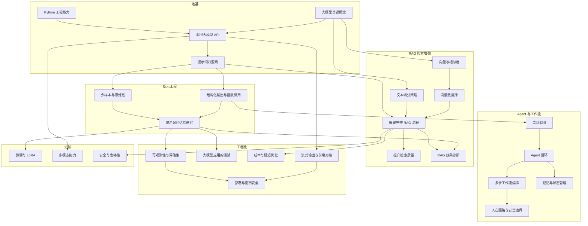

# 附录 A · 初始路线数据

> 这是 Routebook 内置的第一条路线模板：「AI 大模型应用开发」，共 **6 个模块、26 个节点**。
>
> **用途**：`db/seed.py` 用它初始化数据（见 `02-领域模型与数据库设计.md` §5.2）。
> 也是 `08-开发计划.md` 里"里程碑 ↔ 学习节点"对应关系的依据。

---

## A.1 使用说明

### 数据流

```
本文档的 JSON
    ↓  复制到 backend/src/routebook/db/templates/ai_app_dev.json
seed.py 读取
    ↓  为每个节点生成 UUID
    ↓  用符号 id（如 "python-eng"）建立 depends_on 的 UUID 映射
    ↓  写入 nodes / node_dependencies / resources 三张表
数据库
```

### 两个关键说明

**1. 符号 id 与真实 UUID**

本文档里的 `id`（如 `python-eng`）是**符号 id**，只在模板文件内部用于表达依赖关系。入库时会转换成 UUID。

`seed.py` 必须做这三步：

```python
# 1. 第一遍：创建所有节点，建立 符号id → UUID 的映射
id_map: dict[str, UUID] = {}
for module in template["modules"]:
    for node in module["nodes"]:
        uuid = uuid4()
        id_map[node["id"]] = uuid
        session.add(Node(
            id=uuid,
            route_id=route_id,
            title=node["title"],
            summary=node.get("summary", ""),
            exit_criteria=node["exit_criteria"],
            level=node["level"],
            position=node["position"],
            module_name=module["name"],        # 模块名写进节点的冗余字段
        ))

await session.flush()      # 必须先 flush，否则下面的外键引用不到

# 2. 第二遍：创建依赖边（用映射把符号 id 换成 UUID）
for module in template["modules"]:
    for node in module["nodes"]:
        for dep_symbol in node["depends_on"]:
            session.add(NodeDependency(
                node_id=id_map[node["id"]],
                depends_on_id=id_map[dep_symbol],
            ))

# 3. 第三遍：创建资源
```

**2. `modules` 不是一张表**

`02-领域模型与数据库设计.md` §3.3 说明过：模块只是展示用的分组，不建表。入库时把 `module["name"]` 写进节点的 `module_name` 字段。

---

## A.2 依赖关系图



---

## A.3 模块总览

| # | 模块 | 描述 | 节点数 | 特征 |
|---|---|---|---|---|
| 0 | **地基** | 先能跑起来，再谈架构 | 4 | 全部无前置依赖或互为基础 |
| 1 | **提示工程** | 把模型当人使，而不是当接口调 | 3 | 从这里开始需要"手感" |
| 2 | **RAG 检索增强** | 让模型读你自己的资料 | 6 | 节点最多，是 AI 应用开发的核心 |
| 3 | **Agent 与工作流** | 从"问答"到"办事" | 5 | 难度跃升的一个阶梯 |
| 4 | **工程化** | 能跑不算数，能上线才算 | 5 | 决定项目能不能长期活下去 |
| 5 | **进阶** | 到这一步，你已经能自己判断该学什么了 | 3 | 按需选学 |

---

## A.4 完整数据（JSON）

```json
{
  "template_key": "ai-app-dev",
  "title": "AI 大模型应用开发",
  "description": "从零到能独立开发一个可上线的 LLM 应用。以工程实践为主线，不做模型训练。",
  "updated": "2026-10-12",
  "modules": [
    {
      "name": "地基",
      "position": 0,
      "description": "先能跑起来，再谈架构",
      "nodes": [
        {
          "id": "python-eng",
          "title": "Python 工程能力",
          "summary": "虚拟环境、依赖管理、类型注解、项目结构",
          "level": 1,
          "position": 0,
          "depends_on": [],
          "exit_criteria": "能写一个带类型注解、用虚拟环境管理依赖的小项目，知道 import 报错时该按什么顺序排查",
          "resources": [
            { "name": "Python 官方教程（中文）", "location": "docs.python.org/zh-cn/3/tutorial", "kind": "doc" },
            { "name": "《流畅的 Python》类型注解章节", "location": "书 / 微信读书", "kind": "book" }
          ]
        },
        {
          "id": "llm-concept",
          "title": "大模型关键概念",
          "summary": "token、上下文窗口、温度、幻觉",
          "level": 1,
          "position": 1,
          "depends_on": [],
          "exit_criteria": "能用大白话解释 token、上下文窗口、温度、幻觉这四个词分别意味着什么，并举出一个自己遇到的例子",
          "resources": [
            { "name": "OpenAI 文档 Concepts 章节", "location": "platform.openai.com → Docs → Concepts", "kind": "doc" },
            { "name": "3Blue1Brown 神经网络系列", "location": "B站搜「3Blue1Brown 神经网络」", "kind": "video" }
          ]
        },
        {
          "id": "llm-api",
          "title": "调用大模型 API",
          "summary": "消息格式、流式响应、错误处理",
          "level": 1,
          "position": 2,
          "depends_on": ["python-eng", "llm-concept"],
          "exit_criteria": "跑通一次流式对话，并且能看懂返回结构里每一个字段是干什么的",
          "resources": [
            { "name": "所选模型的官方 Quickstart", "location": "OpenAI / 阿里百炼 / 智谱 等官方文档", "kind": "doc" },
            { "name": "OpenAI Cookbook", "location": "github.com/openai/openai-cookbook", "kind": "repo" }
          ]
        },
        {
          "id": "prompt-basic",
          "title": "提示词四要素",
          "summary": "角色、任务、约束、示例",
          "level": 1,
          "position": 3,
          "depends_on": ["llm-api"],
          "exit_criteria": "能写出「角色 + 任务 + 约束 + 示例」四要素齐全的 prompt，并能说清少了哪一个会出什么问题",
          "resources": [
            { "name": "Prompt Engineering Guide", "location": "promptingguide.ai（只读入门章节）", "kind": "doc" }
          ]
        }
      ]
    },
    {
      "name": "提示工程",
      "position": 1,
      "description": "把模型当人使，而不是当接口调",
      "nodes": [
        {
          "id": "prompt-cot",
          "title": "少样本与思维链",
          "summary": "Few-shot、Chain of Thought",
          "level": 2,
          "position": 0,
          "depends_on": ["prompt-basic"],
          "exit_criteria": "对同一个任务写出「直接问」和「分步推理」两版 prompt，并说清它们各在什么场景下更好",
          "resources": [
            { "name": "Prompt Engineering Guide 的 CoT 章节", "location": "promptingguide.ai", "kind": "doc" }
          ]
        },
        {
          "id": "structured-output",
          "title": "结构化输出与函数调用",
          "summary": "JSON Schema、Function Calling",
          "level": 2,
          "position": 1,
          "depends_on": ["prompt-basic"],
          "exit_criteria": "连续十次调用都能拿到合法 JSON（不会崩），并让模型成功触发一次你定义的函数",
          "resources": [
            { "name": "模型官方的 Function Calling 指南", "location": "OpenAI Docs → Function calling", "kind": "doc" }
          ]
        },
        {
          "id": "prompt-eval",
          "title": "提示词评估与迭代",
          "summary": "测试集、通过率、回归",
          "level": 3,
          "position": 2,
          "depends_on": ["prompt-cot", "structured-output"],
          "exit_criteria": "准备 10 条固定测试样例，改完 prompt 后能判断这次改动是变好还是变坏 —— 而不是靠感觉",
          "resources": [
            { "name": "自己动手建：把 10 条样例写进一个文件", "location": "这是本节点最重要的产出物，比读任何文章都有用", "kind": "other" }
          ]
        }
      ]
    },
    {
      "name": "RAG 检索增强",
      "position": 2,
      "description": "让模型读你自己的资料",
      "nodes": [
        {
          "id": "chunking",
          "title": "文本切分策略",
          "summary": "固定长度、按结构、按语义的取舍",
          "level": 2,
          "position": 0,
          "depends_on": ["llm-concept"],
          "exit_criteria": "说清固定长度、按文档结构、按语义三种切分各自的取舍，并知道切太碎会坏在哪",
          "resources": [
            { "name": "LangChain 文档 Text Splitters", "location": "python.langchain.com", "kind": "doc" }
          ]
        },
        {
          "id": "embedding",
          "title": "向量与相似度",
          "summary": "Embedding、余弦相似度",
          "level": 2,
          "position": 1,
          "depends_on": ["llm-concept"],
          "exit_criteria": "能解释余弦相似度在干什么，并随手举出两句话为什么「近」或「远」",
          "resources": [
            { "name": "OpenAI Embeddings 指南", "location": "platform.openai.com → Docs → Embeddings", "kind": "doc" }
          ]
        },
        {
          "id": "vector-db",
          "title": "向量数据库",
          "summary": "存储、索引、相似度检索",
          "level": 2,
          "position": 2,
          "depends_on": ["embedding"],
          "exit_criteria": "把 1000 条数据存进去，并成功检索出相关片段（本地用 Chroma 或 pgvector 就够，别上云）",
          "resources": [
            { "name": "Chroma 官方入门", "location": "docs.trychroma.com", "kind": "doc" },
            { "name": "pgvector README", "location": "github.com/pgvector/pgvector", "kind": "repo" }
          ]
        },
        {
          "id": "rag-pipeline",
          "title": "搭建完整 RAG 流程",
          "summary": "切分 → 向量化 → 检索 → 生成",
          "level": 3,
          "position": 3,
          "depends_on": ["chunking", "vector-db", "prompt-basic"],
          "exit_criteria": "对着一份自己的文档提问，答案里能带出处，并且你知道每一行代码在干嘛",
          "resources": [
            { "name": "RAG 原始论文", "location": "arxiv.org/abs/2005.11401（读摘要和第一张图就够）", "kind": "paper" },
            { "name": "LangChain RAG 教程", "location": "python.langchain.com", "kind": "doc" }
          ]
        },
        {
          "id": "rag-retrieval-plus",
          "title": "提升检索质量",
          "summary": "混合检索、重排、查询改写",
          "level": 3,
          "position": 4,
          "depends_on": ["rag-pipeline"],
          "exit_criteria": "说清混合检索、重排 rerank、查询改写这三招各自解决的是什么问题，以及它们为什么不能互相替代",
          "resources": [
            { "name": "检索增强生成综述", "location": "arxiv 搜「Retrieval-Augmented Generation survey」", "kind": "paper" }
          ]
        },
        {
          "id": "rag-eval",
          "title": "RAG 效果诊断",
          "summary": "定位是检索问题还是生成问题",
          "level": 3,
          "position": 5,
          "depends_on": ["rag-pipeline", "prompt-eval"],
          "exit_criteria": "一次答错时，你能判断是「没检索到」还是「检索到了但没答对」—— 这两种修法完全不同",
          "resources": [
            { "name": "RAGAS 评估框架", "location": "docs.ragas.io", "kind": "doc" }
          ]
        }
      ]
    },
    {
      "name": "Agent 与工作流",
      "position": 3,
      "description": "从「问答」到「办事」",
      "nodes": [
        {
          "id": "tool-use",
          "title": "工具调用",
          "summary": "让模型决定何时调用函数",
          "level": 2,
          "position": 0,
          "depends_on": ["structured-output"],
          "exit_criteria": "让模型自己决定什么时候调用你写的那个函数，而不是你写 if-else 去猜",
          "resources": [
            { "name": "OpenAI Function Calling 指南", "location": "platform.openai.com → Docs", "kind": "doc" }
          ]
        },
        {
          "id": "agent-loop",
          "title": "Agent 循环（ReAct）",
          "summary": "思考 → 行动 → 观察 → 再思考",
          "level": 3,
          "position": 1,
          "depends_on": ["tool-use"],
          "exit_criteria": "实现「思考 → 行动 → 观察 → 再思考」的循环，并且设好终止条件（不然会烧钱）",
          "resources": [
            { "name": "ReAct 论文", "location": "arxiv.org/abs/2210.03629", "kind": "paper" }
          ]
        },
        {
          "id": "workflow",
          "title": "多步工作流编排",
          "summary": "固定节点编排 vs 自由 Agent",
          "level": 3,
          "position": 2,
          "depends_on": ["agent-loop"],
          "exit_criteria": "把一个复杂任务拆成固定节点串起来，并知道什么时候该用「工作流」而不是「放手让 Agent 自己跑」",
          "resources": [
            { "name": "Anthropic 关于工作流与 Agent 的对比文章", "location": "anthropic.com → Engineering", "kind": "doc" },
            { "name": "LangGraph 文档", "location": "langchain-ai.github.io/langgraph", "kind": "doc" }
          ]
        },
        {
          "id": "memory-state",
          "title": "记忆与状态管理",
          "summary": "让助手记住上一轮的结论",
          "level": 3,
          "position": 3,
          "depends_on": ["agent-loop"],
          "exit_criteria": "让助手记住上一轮的结论并在下一轮真的用上 —— 这一步做完，你就理解了 Routebook 这个项目本身的原理",
          "resources": [
            { "name": "LangGraph 的 Memory 章节", "location": "langchain-ai.github.io/langgraph", "kind": "doc" }
          ]
        },
        {
          "id": "human-in-loop",
          "title": "人在回路与安全边界",
          "summary": "危险操作必须人工确认",
          "level": 2,
          "position": 4,
          "depends_on": ["workflow"],
          "exit_criteria": "给删除、发送、付款这类危险操作加上人工确认，不给模型自己决定的机会",
          "resources": [
            { "name": "OWASP LLM Top 10", "location": "owasp.org 搜 LLM Top 10", "kind": "doc" }
          ]
        }
      ]
    },
    {
      "name": "工程化",
      "position": 4,
      "description": "能跑不算数，能上线才算",
      "nodes": [
        {
          "id": "streaming",
          "title": "流式输出与前端对接",
          "summary": "SSE、逐字渲染、中断处理",
          "level": 2,
          "position": 0,
          "depends_on": ["llm-api"],
          "exit_criteria": "在页面上看到回答一个字一个字地冒出来，并且中途关闭页面时已生成的内容不会丢",
          "resources": [
            { "name": "模型官方文档的 Streaming 章节", "location": "所选模型的官方文档", "kind": "doc" }
          ]
        },
        {
          "id": "llm-testing",
          "title": "大模型应用的测试",
          "summary": "用 Fake 替代真实调用，覆盖失败路径",
          "level": 3,
          "position": 1,
          "depends_on": ["prompt-eval"],
          "exit_criteria": "能用 Fake Provider 写出三个覆盖不同失败路径（超时、非法输出、幻觉）的测试，并说清为什么不能在测试里调真实 API",
          "resources": [
            { "name": "自己动手：给现有的 AI 调用写一个 Fake 实现", "location": "先写 Fake，再写测试，最后才想覆盖率", "kind": "other" }
          ]
        },
        {
          "id": "cost-latency",
          "title": "成本与延迟优化",
          "summary": "缓存、模型分级、并行",
          "level": 3,
          "position": 2,
          "depends_on": ["rag-pipeline"],
          "exit_criteria": "说清缓存、模型分级、请求并行这三招分别省下了什么，并给出你自己的实测数字（不是文章里的数字）",
          "resources": [
            { "name": "自己动手：给现有流程加一层缓存，记录前后耗时", "location": "实测比看文章有用得多", "kind": "other" }
          ]
        },
        {
          "id": "observability",
          "title": "可观测性与评估集",
          "summary": "日志、trace、回归测试",
          "level": 3,
          "position": 3,
          "depends_on": ["prompt-eval"],
          "exit_criteria": "每次改动后自动跑一遍测试集并看到分数，改动是变好还是变坏一眼可见",
          "resources": [
            { "name": "LangSmith 或 Langfuse", "location": "smith.langchain.com / langfuse.com", "kind": "doc" }
          ]
        },
        {
          "id": "deploy-security",
          "title": "部署与密钥安全",
          "summary": "容器化、HTTPS、密钥不进前端",
          "level": 2,
          "position": 4,
          "depends_on": ["streaming", "observability"],
          "exit_criteria": "服务上线可访问，并且密钥绝对不会出现在前端代码或浏览器网络面板里",
          "resources": [
            { "name": "Vercel / Cloudflare Pages 部署文档", "location": "vercel.com/docs", "kind": "doc" }
          ]
        }
      ]
    },
    {
      "name": "进阶",
      "position": 5,
      "description": "到这一步，你已经能自己判断该学什么了",
      "nodes": [
        {
          "id": "finetune",
          "title": "微调与 LoRA",
          "summary": "什么时候该微调，什么时候不该",
          "level": 3,
          "position": 0,
          "depends_on": ["prompt-eval"],
          "exit_criteria": "拿到一个需求时，你能判断它该用提示工程解决，还是真的需要微调 —— 并说出判断依据",
          "resources": [
            { "name": "LoRA 论文", "location": "arxiv.org/abs/2106.09685（读摘要即可）", "kind": "paper" }
          ]
        },
        {
          "id": "multimodal",
          "title": "多模态能力",
          "summary": "图像与语音输入",
          "level": 3,
          "position": 1,
          "depends_on": ["llm-api"],
          "exit_criteria": "完成一次图文混合输入的处理，并知道图片是怎么变成 token 计费的",
          "resources": [
            { "name": "模型的 Vision 文档", "location": "官方文档的 Vision 章节", "kind": "doc" }
          ]
        },
        {
          "id": "safety",
          "title": "安全与鲁棒性",
          "summary": "提示词注入、越权、数据泄露",
          "level": 3,
          "position": 2,
          "depends_on": ["rag-pipeline"],
          "exit_criteria": "复现一次提示词注入攻击，并给出你自己的防御方案 —— 攻击过自己一次，才算真的懂",
          "resources": [
            { "name": "OWASP LLM Top 10", "location": "owasp.org", "kind": "doc" }
          ]
        }
      ]
    }
  ]
}
```

---

## A.5 节点索引

按 id 速查，方便在 `08-开发计划.md` 里对照。

| id | 标题 | 模块 | 难度 | 前置 |
|---|---|---|---|---|
| `python-eng` | Python 工程能力 | 地基 | 1 | — |
| `llm-concept` | 大模型关键概念 | 地基 | 1 | — |
| `llm-api` | 调用大模型 API | 地基 | 1 | python-eng, llm-concept |
| `prompt-basic` | 提示词四要素 | 地基 | 1 | llm-api |
| `prompt-cot` | 少样本与思维链 | 提示工程 | 2 | prompt-basic |
| `structured-output` | 结构化输出与函数调用 | 提示工程 | 2 | prompt-basic |
| `prompt-eval` | 提示词评估与迭代 | 提示工程 | 3 | prompt-cot, structured-output |
| `chunking` | 文本切分策略 | RAG 检索增强 | 2 | llm-concept |
| `embedding` | 向量与相似度 | RAG 检索增强 | 2 | llm-concept |
| `vector-db` | 向量数据库 | RAG 检索增强 | 2 | embedding |
| `rag-pipeline` | 搭建完整 RAG 流程 | RAG 检索增强 | 3 | chunking, vector-db, prompt-basic |
| `rag-retrieval-plus` | 提升检索质量 | RAG 检索增强 | 3 | rag-pipeline |
| `rag-eval` | RAG 效果诊断 | RAG 检索增强 | 3 | rag-pipeline, prompt-eval |
| `tool-use` | 工具调用 | Agent 与工作流 | 2 | structured-output |
| `agent-loop` | Agent 循环（ReAct） | Agent 与工作流 | 3 | tool-use |
| `workflow` | 多步工作流编排 | Agent 与工作流 | 3 | agent-loop |
| `memory-state` | 记忆与状态管理 | Agent 与工作流 | 3 | agent-loop |
| `human-in-loop` | 人在回路与安全边界 | Agent 与工作流 | 2 | workflow |
| `streaming` | 流式输出与前端对接 | 工程化 | 2 | llm-api |
| `llm-testing` | 大模型应用的测试 | 工程化 | 3 | prompt-eval |
| `cost-latency` | 成本与延迟优化 | 工程化 | 3 | rag-pipeline |
| `observability` | 可观测性与评估集 | 工程化 | 3 | prompt-eval |
| `deploy-security` | 部署与密钥安全 | 工程化 | 2 | streaming, observability |
| `finetune` | 微调与 LoRA | 进阶 | 3 | prompt-eval |
| `multimodal` | 多模态能力 | 进阶 | 3 | llm-api |
| `safety` | 安全与鲁棒性 | 进阶 | 3 | rag-pipeline |

**统计**

| 难度 | 数量 |
|---|---|
| L1（入门） | 4 |
| L2（进阶） | 9 |
| L3（高阶） | 13 |
| **合计** | **26** |

---

## A.6 学习顺序建议（前 6 个节点）

从零开始，按依赖关系推导出的前几步：

```
第 1 步：Python 工程能力       （无前置）
第 1 步：大模型关键概念         （无前置，可与上一步并行）
   ↓
第 2 步：调用大模型 API        （需要上面两个）
   ↓
第 3 步：提示词四要素
   ↓
第 4 步：少样本与思维链  ┐
第 4 步：结构化输出      ├─ 这三个可以并行
第 4 步：文本切分策略     ┘
```

**这个推导过程就是 Routebook 的 `list_startable` 在做的事。** 你在 M4 实现的规则版推荐，跑出来应该和上面一致 —— 那就算验证通过了。
